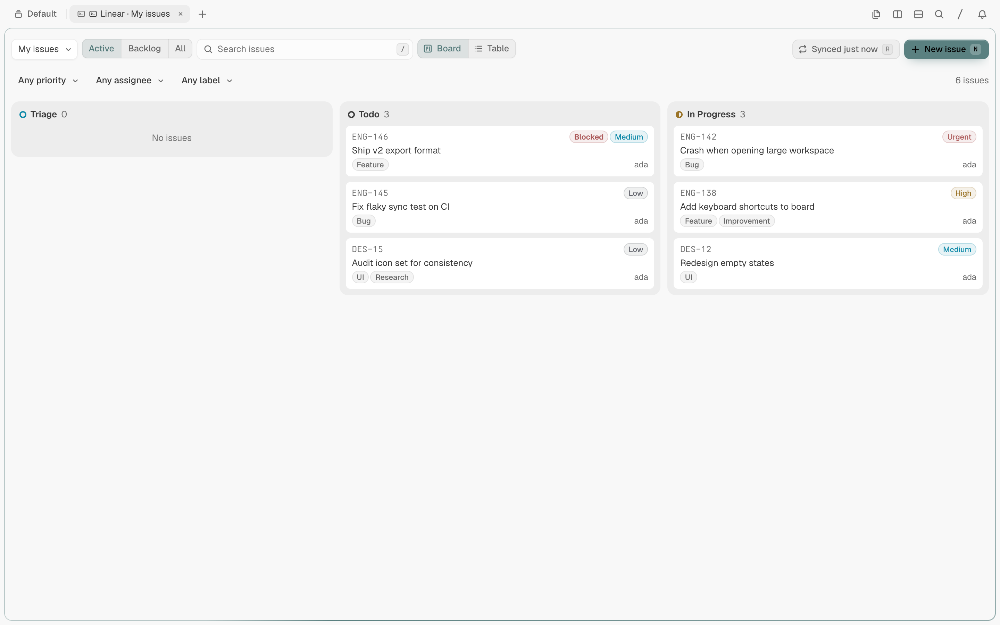
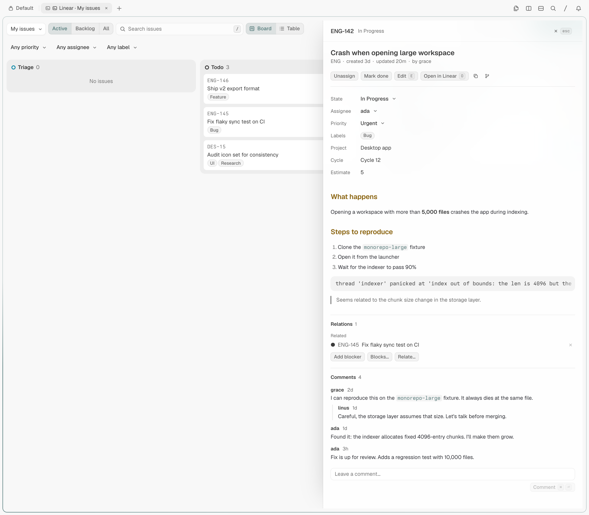
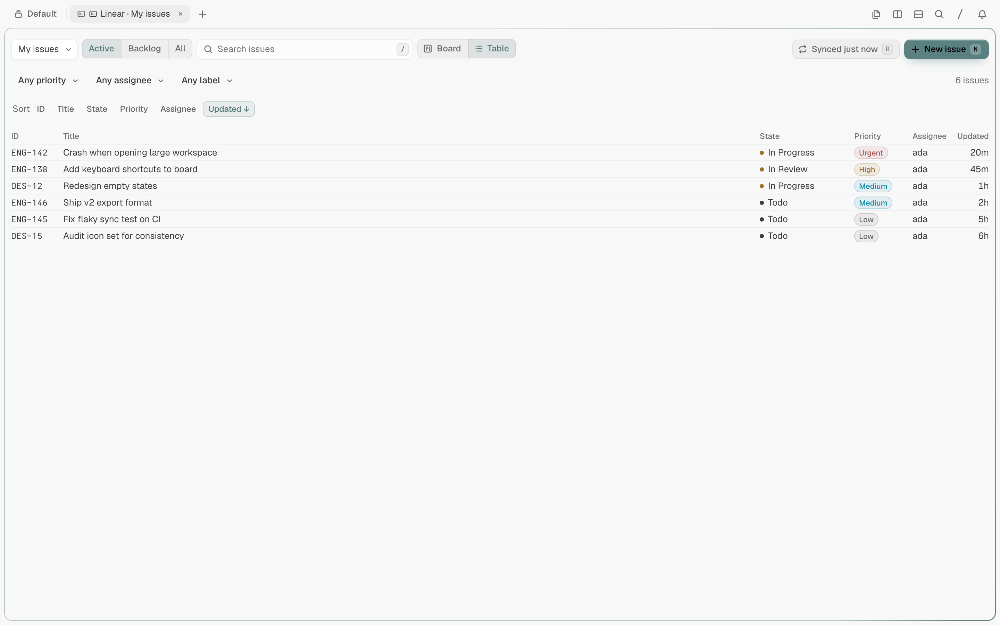
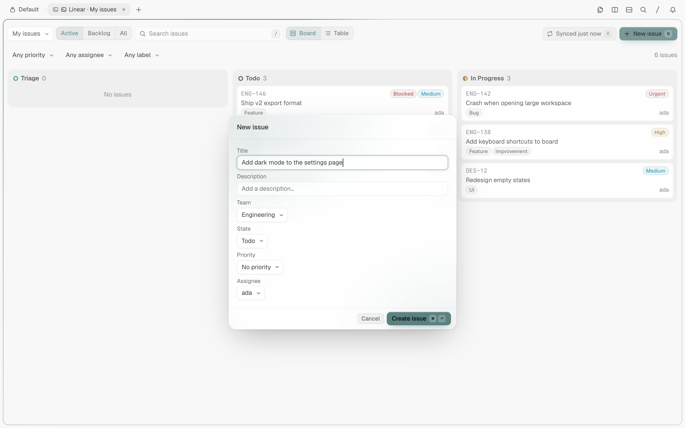
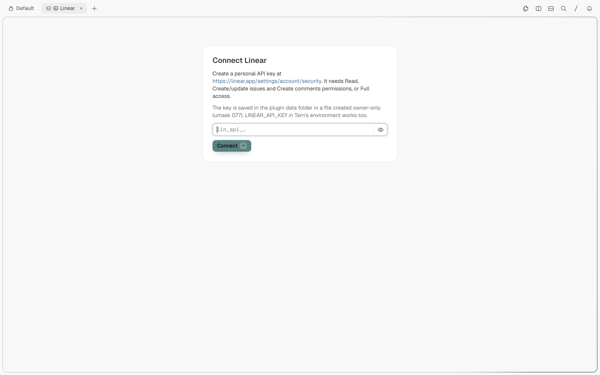

# Linear for Tern

Your Linear issues as a native board in a [Tern](https://stencil.so/tern) pane: browse, search, triage, comment and create without leaving the terminal.



`tern-linear` is a pure-Luau Tern plugin. It adds one block, **Linear**, that talks to Linear's GraphQL API from the Tern host process. There is nothing to run besides Tern: no Node, no Bun, no background service.

## What you get

- Board (one column per workflow state) or sortable table, switched with one key.
- **My issues** (assigned to you, across all teams) or any **team** scope.
- **Active**, **Backlog** and **All** views. Closed issues appear in All only when closed in the last 14 days.
- Search, plus priority, assignee and label filters.
- Detail drawer with the Markdown description, properties, sub-issues, relations and threaded comments.
- Edit title, description, state, priority and assignee; assign to yourself; mark done or reopen; move a card to the previous or next column.
- Create issues in a dialog.
- Link and unlink blockers and related issues by identifier (`ENG-123`); blocked issues carry a `Blocked` badge.
- Keyboard-first, with the usual mouse targets as well.
- Live polling: a cheap change check every 30 seconds and a full reload every 5 minutes.
- Follows your Tern theme (light or dark); no palette of its own.

## Install

```sh
tern plugin install github.com/peterrauscher/tern-linear           # install
tern plugin install github.com/peterrauscher/tern-linear --force   # update
tern plugin remove linear                                          # remove
```

Tern clones the default branch; the repository root is the plugin package. Then open the command palette and run **New Linear block**.

- Remote hosts: install the plugin on the host whose panes it should serve. It has only a host half, so desktop, web and iOS windows attached to a host that has it all render the block from that host.
- Requirements: Tern and a Linear account. Tested on Tern 0.9.14 (Tern is in closed beta).

## Connect your Linear account

### In the block

1. Create a personal API key at <https://linear.app/settings/account/security> (API, **New API key**).
2. Open a Linear block, paste the key (`lin_api_...`) and press **Connect**.

The key is checked against Linear first and only stored when Linear accepts it. **Sign out** in the top bar deletes the stored key.

Permissions: **Full access**, or at least **Read** plus **Write**. Read alone is enough to browse; edits, comments, creating issues and changing relations need Write (the setup screen suggests Read, Create/update issues and Create comments). If you restrict the key to some teams, the block only shows those teams.

### With `LINEAR_API_KEY`

Set `LINEAR_API_KEY` in the environment of the **Tern daemon** (the process that runs the host half), then restart Tern:

```sh
export LINEAR_API_KEY=lin_api_...
```

The environment variable wins over a stored key. A key from the environment is never written to disk and has no Sign out button; if Linear rejects it, the block shows an error banner instead of the setup screen. Setting the variable in a shell that is not the daemon's has no effect.

## Usage

Keys work when no text field has focus. Keys with Ctrl, Alt or Cmd are left to Tern.

| Key | Action |
| --- | --- |
| `/` | Focus search (`Esc` or `Enter` leaves it; the text stays) |
| `1` `2` `3` | Active / Backlog / All |
| `v` | Toggle board and table |
| `m` | My issues |
| `t` | Next team (cycles through your teams) |
| `j` / `Down`, `k` / `Up` | Select next / previous issue |
| `h` / `Left`, `l` / `Right` | Board: first issue of the previous / next column |
| `Enter` | Open the selected issue in the drawer |
| `Esc` | Close the form or link input, else the drawer, else clear the selection |
| `n` | New issue |
| `e` | Edit the selected issue |
| `c` | Focus the comment box (drawer open) |
| `a` | Assign to me (unassign if already yours) |
| `x` | Mark done (reopen if closed) |
| `[` / `]` | Move to the previous / next column's state |
| `o` | Open in Linear |
| `y` | Copy the identifier |
| `r` | Refresh |

In fields: `Tab` and `Shift+Tab` move between form fields; `Up`/`Down` (or `Left`/`Right`) step through the options of a choice field; `Enter` submits single-line fields; `Ctrl+Enter` or `Cmd+Enter` submits multi-line fields and the comment box; `Esc` leaves the comment box and cancels forms and the link input. On the setup screen `Enter` connects.

Mouse: click a card to select it and open the drawer; click a table row to select it, and activate it to open the drawer. The top bar has the scope selector, view tabs, layout toggle and the **Refresh**, **New issue** and **Sign out** buttons; the filter row has the priority, assignee and label selects; the table has **Sort** buttons. The drawer has buttons for done/reopen, edit, open in Linear, copying the identifier or branch name, and **Add blocker**, **Blocks** and **Related** links.

| Detail drawer | Table | Create dialog |
| --- | --- | --- |
|  |  |  |

The setup screen, shown until a key is stored or supplied:



## Security and privacy

- **Network**: the plugin's own requests go only to Linear's GraphQL endpoint, `https://api.linear.app/graphql`, with your key in the `Authorization` header (personal keys as-is; keys starting with `lin_oauth_` as `Bearer`). **Open in Linear** (`o`) opens the issue URL only when it starts with `https://linear.app/`; anything else is refused.
- **Key storage**: a key pasted into the block is written to `credentials.json` in the plugin's data folder (managed by Tern). On macOS and Linux the write goes through `/bin/sh` with `umask 077`, so the file is created owner-only (`600`) and the data directory is `700`; the key is not passed on the command line. Windows writes the file through Tern's filesystem API. Tern's keychain (`tern.secrets`) is only available to window halves, and this plugin has only a host half, so it cannot use it. A key supplied through `LINEAR_API_KEY` is never stored by the plugin. The key is not logged and is not shown again after you submit it.
- **Processes**: the only process the plugin starts is that `/bin/sh` write of the key file. It runs no other commands.
- **Data at rest**: issues, comments and drafts live in memory only. The plugin persists your layout, view, scope, team and table sort, nothing else.
- **Markdown**: descriptions and comments are passed through a sanitizer before Tern renders them. Images become links (nothing loads on its own). Link targets are kept only for `http`, `https` and `mailto`; other targets, including `file:` and custom schemes, are dropped. Code spans and fenced code blocks are left as Linear wrote them.
- **Test override**: `LINEAR_API_URL` can point the plugin at a mock GraphQL endpoint. It is read only from the Tern daemon's environment, and it is accepted only for `https://api.linear.app/graphql` or an `http`/`https` URL on `127.0.0.1`, `localhost` or `[::1]`. Any other value is ignored: the key is not sent, and the setup screen shows why. Leave it unset.

## Limits and known issues

- A view loads at most 250 issues. When more match, the filter row shows `Showing first 250`; narrow the view, scope or filters.
- No drag and drop: Tern blocks have no pointer drag. Move cards with `[` / `]` or the State select.
- Labels are shown and filterable but not editable, neither when editing nor when creating an issue. Project, cycle, estimate and due date are display-only too.
- Assignee choices are the issue's team members; state choices are the issue's team states.
- No OAuth. Authentication is a personal API key.
- The keychain is not available to host-only plugins, so a pasted key is stored in a file (see above).
- Updates are polled, not pushed: other people's changes appear within about 30 seconds. Polling pauses while a form is open or the comment box or link input has focus.
- Each Linear block polls on its own; many blocks multiply the request rate.
- Text fields are drawn by the plugin from keystrokes and Tern's native edit events (the block declares the `edit` feature). How much editing works beyond typing, deleting and cursor movement follows Tern's native editing support for blocks.

## Troubleshooting

- **"Linear rejected the API key"**: the key is invalid, revoked or mistyped. Create a new one and paste it again. If the key comes from `LINEAR_API_KEY`, fix the variable and restart Tern.
- **"Your API key is not allowed to do that."**: the key lacks Write permission, or the team is outside the key's team access.
- **"Rate limited by Linear; retrying in Ns"**: Linear allows 2,500 requests per hour per user for API keys. The plugin polls cheaply (one small change check every 30 seconds per block, a full reload every 5 minutes, and a refresh of the open drawer on each poll) and backs off for the time Linear asks, at least 60 seconds when Linear gives none. Close extra Linear blocks if you run many.
- **My issues is empty**: it shows what is assigned to you in the current view. The empty Active view says so and offers **All** and **Choose team** (switches to the next team). `3` and `t` do the same. A filtered empty view offers **Clear filters**.
- **Logs**: `~/Library/Logs/Tern`. For plugin detail, start Tern with `STENCIL_LOG=warn,tern::plugin=debug`. The key is never logged.
- **Is it installed?** `tern plugin list` shows `linear`.

## Development

```sh
bun install            # graphql, used to validate queries
bun run check          # everything below, in order
bun run format         # StyLua
bun run smoke:live     # read-only smoke test against the real API (needs LINEAR_API_KEY)
tern plugin link .     # use this checkout as the installed plugin
```

`bun run check` runs the format check, the luau-lsp typecheck, the unit tests (Luau CLI), validation of every GraphQL document against Linear's public schema, and the headless end-to-end test. The tools (luau-lsp, StyLua, Luau, the Linear SDL) are downloaded into `.cache/` by `scripts/fetch-tools.sh` on first use; macOS and Linux only. The end-to-end test needs `tern` on your `PATH`.

Test strategy:

- `test/unit`: the pure logic only (`lib/model.luau`, `lib/text.luau`), run with the `luau` CLI.
- `test/validate-queries.mjs`: every operation in `lib/queries.luau` validates against Linear's SDL.
- `test/e2e.mjs`: starts a real headless `tern serve`, loads the plugin as a fixture and drives the UI against a stateful mock of Linear (`test/mock-linear.mjs`). It writes screenshots and `report.json` to `e2e-artifacts/`.
- `test/live-smoke.mjs`: the same harness against the real API. Read-only by default; `--write` also creates, comments on and completes one issue. The key comes from `LINEAR_API_KEY`.

Module boundaries, request discipline, actions, keys and test hooks are in [docs/ARCHITECTURE.md](docs/ARCHITECTURE.md).

## Credits

Inspired by [beads-tern](https://github.com/Roflochinsky/beads-tern) by Roflochinsky. Not affiliated with, endorsed by or sponsored by Linear or Stencil.

## License

[MIT](LICENSE)
