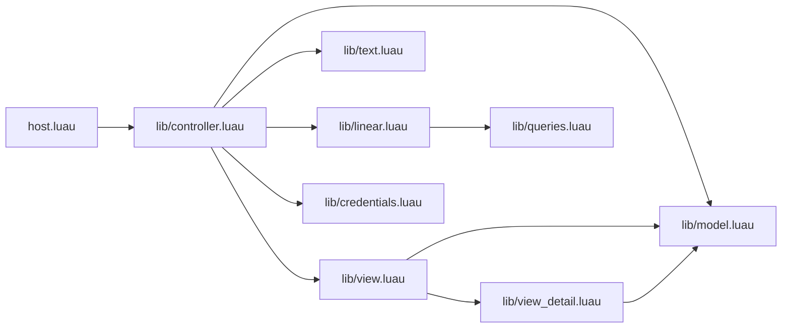

# tern-linear architecture

A pure-Luau Tern plugin. The host half defines one block, `linear.board`, that talks to Linear's GraphQL API with `tern.fetch`. There is no window half, no Node bridge and no background service. Types live in [`lib/types.luau`](../lib/types.luau); this document gives their meaning and the contracts between modules.



| File | Owns | Must not |
| --- | --- | --- |
| `host.luau` | `tern.block.define("board", controller.def)` and nothing else | hold logic |
| `lib/types.luau` | shared types | change without updating this doc |
| `lib/queries.luau` | GraphQL document strings, one operation each | build queries dynamically |
| `lib/linear.luau` | HTTP, auth header, error classification, rate headers, paging, normalization into `types.*` | touch block state or `cx` |
| `lib/credentials.luau` | API key resolution, storage, endpoint | log or display the key |
| `lib/model.luau` | pure board logic: grouping, filtering, sorting, server filter, blocked, default states, dates, edit diffs | call `tern.*` (pure Luau; unit-tested with the `luau` CLI) |
| `lib/text.luau` | UTF-16 controlled text fields; `safeMarkdown` for descriptions and comments | call `tern.*` |
| `lib/controller.luau` | `BlockDef`, state, keys, events, actions, request discipline, polling, forms | build nodes |
| `lib/view.luau` | `main` region, top bar, filters, board, table, setup screen, empty/error states; composes the `layer` from `view_detail` | mutate state |
| `lib/view_detail.luau` | `layer` region: detail drawer, inline edit form, comments, relations, create dialog; both overlays use the single key `layer.panel` so field ids stay stable | mutate state |
| `styles/linear.css` | styles for `view.luau` | style `.sf-layer` or unscoped selectors |
| `styles/detail.css` | styles for `view_detail.luau` | style `main` |

Every module starts with `--!strict` and requires siblings with `require("./x")` (from `host.luau`: `require("./lib/x")`). Modules return a table of functions; no module keeps mutable globals except `controller.luau`'s run registry and `linear.luau`'s last rate info.

## Module APIs

### `lib/queries.luau`

```luau
local queries = {}
queries.Viewer = [[query Viewer { ... }]]
-- Teams, TeamMore, Issues, Issue, IssueCreate, IssueUpdate, CommentCreate,
-- IssueRelationCreate, IssueRelationDelete, IssueLookup, IssuesChanged
return queries
```

Each value is exactly one named operation in a `[[ ... ]]` long string, the operation name equal to the key. `test/validate-queries.mjs` extracts them with the pattern `queries.<Name> = [[<doc>]]` and validates against Linear's public SDL. `Teams` uses `$first: Int = 5` (live cost of `first: 10` was 6330 of the 10000 cap).

### `lib/credentials.luau`

```luau
credentials.resolve(): (types.Config?, string?) -- env LINEAR_API_KEY, else the key file; nil + reason when a key exists but LINEAR_API_URL is rejected; nil when neither
credentials.source(): ("env" | "file")?
credentials.save(key: string, cb: (ok: boolean, err: string?) -> ()) -- POSIX: owner-only write via /bin/sh (umask 077, dir 700, file 600); Windows: tern.fs.write
credentials.clear(): (boolean, string?)       -- deletes the key file; false if it is still there; env keys are untouched
credentials.endpoint(): (string?, string?)    -- https://api.linear.app/graphql, or http(s) on 127.0.0.1 / localhost / [::1]; nil + reason when LINEAR_API_URL is anything else
credentials.looksLikeKey(s: string): boolean  -- trimmed, starts with "lin_api_" or "lin_oauth_", no whitespace
```

Key file: `tern.plugin.data .. "/credentials.json"`, JSON `{ "apiKey": "…" }`; reads are capped at 16 KiB and a missing, unreadable or corrupt file counts as "no key". On POSIX, `save` writes through `/bin/sh` with `umask 077` (temp file, then `mv`) and `chmod 700` on the data directory, so the key is never created world-readable and never appears in argv. Windows uses `tern.fs.write`. `clear` removes the file and checks it is gone. That shell is the only process the plugin starts. Personal keys go in `Authorization: <key>` (no `Bearer`); keys starting with `lin_oauth_` get `Bearer `. `tern.secrets` is window-only, so the host half cannot use the keychain. `LINEAR_API_URL` is read only from the daemon environment and is accepted only for Linear's endpoint or a loopback URL (the mock server); any other value withholds the key and returns a fixed error that does not echo the URL. Descriptions and comments pass through `text.safeMarkdown` before `ui.md`: images become links, and link targets other than `http`, `https` and `mailto` are dropped.

### `lib/linear.luau`

All functions are asynchronous and call `cb(result, nil)` or `cb(nil, err)` exactly once, from a fetch callback (no `cx`). They never raise for network or API failures.

```luau
linear.viewer(cfg, cb: Callback<Viewer>)
linear.teams(cfg, cb: Callback<{Team}>)                     -- pages teams; follows TeamMore overflow
linear.issues(cfg, filter: any, cb: Callback<IssuePage>)    -- pages Issues (first 50) up to MAX_ISSUES = 250
linear.changedSince(cfg, filter: any, sinceIso: string?, cb: Callback<string?>)
    -- IssuesChanged with filter AND {updatedAt: {gt: sinceIso}}; result = newest updatedAt or nil
linear.issue(cfg, id: string, cb: Callback<Issue>)          -- detail; all comment pages, ascending
linear.lookup(cfg, identifier: string, cb: Callback<IssueRef?>) -- nil result (no error) when not found
linear.createIssue(cfg, input: IssueCreateInput, cb: Callback<Issue>)
linear.updateIssue(cfg, id: string, patch: {[string]: any}, cb: Callback<Issue>)
    -- patch keys are IssueUpdateInput keys; a value of tern.json.null clears (e.g. assigneeId)
linear.createComment(cfg, issueId: string, body: string, cb: Callback<Comment>)
linear.createRelation(cfg, issueId: string, relatedIssueId: string, kind: string, cb: Callback<boolean>)
linear.deleteRelation(cfg, relationId: string, cb: Callback<boolean>)
linear.rate(): RateInfo
```

Error classification (`ApiError.kind`): `status == 0` or timeout → `network`; HTTP 401 or `AUTHENTICATION_ERROR` → `auth`; 403 or `FORBIDDEN` → `forbidden`; `RATELIMITED` at any status → `rate` (`retryAfterMs` from `retry-after` seconds, else reset headers minus now, floor 60 000); `Entity not found` / `ENTITY_NOT_FOUND` → `notfound`; `userError == true` or `INPUT_ERROR` → `input` with `userPresentableMessage`; anything else → `server`. A mutation payload with `success == false` is `server`. Messages never include the key.

Normalization: `Issue.relations` merges `relations` (direction `outgoing`) and `inverseRelations` (direction `incoming`); `labels` drops nothing; `assignee` is nil when null (note `tern.json.decode` drops null members). `Team.states` is sorted by `model.STATE_TYPES` rank then `position`; group labels and inactive members are removed. Timeouts: 20 s per request.

### `lib/text.luau`

```luau
text.new(s: string?): Field                 -- cursor at end, no anchor
text.len16(s: string): number               -- UTF-16 length
text.set(f: Field, s: string): ()
text.trimmed(f: Field): string
text.key(f: Field, key: Key, multiline: boolean): boolean
    -- editing keys: printable text, paste (newlines → spaces when single-line), backspace, delete,
    -- left/right/home/end (shift extends selection), alt/ctrl word moves optional, cmd/ctrl+a select all,
    -- enter inserts "\n" only when multiline and no modifier. Returns false for keys it does not use.
text.applyEdit(f: Field, ev: UiEvent): boolean  -- native `edit` event; ignored unless ev.len == len16(text)
```

Pure Luau; code points above U+FFFF count as 2 UTF-16 units.

### `lib/model.luau`

```luau
model.STATE_TYPES: {string}   -- {"triage","backlog","unstarted","started","completed","canceled","duplicate"}
model.TYPE_TITLES: {[string]: string} -- triage "Triage", backlog "Backlog", unstarted "Todo", started "In Progress",
                                      -- completed "Done", canceled "Canceled", duplicate "Duplicate"
model.PRIORITIES: {{value: number, label: string}} -- 1 Urgent, 2 High, 3 Medium, 4 Low, 0 No priority
model.typeRank(t: string): number
model.isClosedType(t: string): boolean       -- completed, canceled, duplicate
model.isBlocked(issue: Issue): boolean       -- incoming "blocks" relation whose other side is not closed
model.blockers(issue: Issue): {IssueRef}
model.viewTypes(view: string): {string}      -- state types shown by a Prefs.view
model.serverFilter(prefs: Prefs): any        -- IssueFilter JSON value (plain tables; arrays as Lua lists)
model.visible(issues, prefs, query: string, viewerId: string?): {Issue}
    -- client filters (query over identifier/title/labels/assignee, priority, assignee, label), deduped by id,
    -- ordered for the board: column order, then priority (1..4 then 0), then sortOrder
model.columns(visible: {Issue}, prefs: Prefs, team: Team?): {Column}
    -- team scope: one column per workflow state of the team whose type is in viewTypes(prefs.view)
    --   (empty ones included); mine scope: one column per state type in viewTypes (empty ones included)
model.sortTable(visible, key: string, asc: boolean): {Issue}
model.stateFor(team: Team, stateType: string): WorkflowState?  -- lowest position of that type
model.doneState(team), model.todoState(team), model.startedState(team): WorkflowState?
model.adjacentState(team: Team, issue: Issue, delta: number, view: string): WorkflowState?
    -- the previous/next column's state for `[` / `]` moves
model.priorityLabel(p: number): string
model.epoch(iso: string): number?            -- UTC seconds; handles fractional seconds and Z/offsets
model.relativeTime(iso: string, now: number): string  -- "now", "5m", "3h", "2d", "Mar 4"
model.parseIdentifier(s: string): (string?, number?)  -- "eng-12" → "ENG", 12
model.formDiff(form: Form): {[string]: string}  -- fields whose current value differs from baseline
```

`Column = { id: string, title: string, stateType: string, stateId: string?, color: string?, issues: {Issue} }` is exported from `model.luau` as `model.Column`.

### `lib/controller.luau`

Exports `controller.def: BlockDef<BlockState>` with `font = "sans"`, `features = { "edit" }`, `init`, `view` (delegates to `view.render`), `title`, `key`, `event`, `save`.

- `save` persists `Prefs` only. Data, drafts, errors and the key are never saved.
- `title` returns `"Linear"`, or `"Linear · <TEAM KEY>"` / `"Linear · My issues"` once ready.
- `init` resolves credentials: none → `phase = "setup"`, focus the key field; otherwise `phase = "loading"`, foreground load (`viewer` → `teams` → `issues`).

Request discipline (learned from beads-tern):

1. Foreground requests set `busy` and increment `generation`. A second foreground request while `busy` is refused (the views disable mutating actions while busy).
2. Background reads set `refreshing` only. They never gate keys or clicks. A background result is dropped if `generation` changed since it started.
3. Every completion callback first checks liveness: the block's pane is still in `tern.pane.list()` and the run registry still maps the pane to this state (a restart reuses pane ids).
4. Mutations are followed by an authoritative reload of the board (background) and, if the drawer is open, of the detail. No optimistic updates except applying the returned issue to the list.
5. A failure sets `state.error` (banner) or `form.error` / `link.error` (inline). `auth` errors return to `phase = "setup"` with `setupError`. `rate` errors set `backoffUntil`.

Polling: every 30 s, when not busy/refreshing, no form open, focus not in `comment`/`form`/`link`, and not backing off: `changedSince(serverFilter, maxUpdatedAt)`; when it returns something newer, background `issues` reload. Every 5 minutes a background `issues` reload regardless. While the drawer is open, the detail is reloaded on the same 30 s tick. Polling stops when the block's pane is gone.

Focus: `state.focus` decides which field gets keys. The controller sends `cx:frame({{"focus", view.fieldId(name)}})` when focus changes and `{"focus", tern.json.null}` when it clears; `ev.ev == "focus"` and `ev.ev == "edit"` are mapped back with `view.fieldName(ev.id)`.

### `lib/view.luau`

```luau
view.render(state: BlockState, cx: BlockCx): BlockView   -- main + layer (from view_detail)
view.fieldId(name: string): string                       -- full node id for a focusable field
view.fieldName(id: string): string?                      -- inverse; nil for non-fields
```

Field names: `"search"`, `"setup"`, `"comment"`, `"link"`, `"form:<FormField.name>"`. `view.luau` owns `search` and `setup` and delegates the others to `view_detail.fieldId/fieldName`.

### `lib/view_detail.luau`

```luau
detail.layer(state: BlockState, cx: BlockCx): Node?      -- layer region root (a col holding one overlay keyed "panel") or nil
detail.fieldId(name: string): string?
detail.fieldName(id: string): string?
```

## Actions (view → controller)

Views attach `actions = { click = "<act>=<value>" }`. Tern splits at the first `=` into `ev.act` and `ev.value`. The controller handles exactly these:

| Action | Meaning |
| --- | --- |
| `refresh` | foreground board reload |
| `layout=board` / `layout=table` | switch layout |
| `view=active` / `view=backlog` / `view=all` | switch view |
| `scope=mine` | issues assigned to me, all teams |
| `team=<teamId>` | team scope |
| `sort=<key>` | table sort; same key toggles direction |
| `clear-filters` | priority/assignee/label filters and query cleared |
| `select=<issueId>` | select and open the drawer |
| `close-detail` | close the drawer |
| `open-url=<issueId>` | `cx:open` only when `issue.url` matches `^https://linear%.app/`; otherwise a notice |
| `copy-id=<issueId>` / `copy-branch=<issueId>` | `cx:copy` identifier / branch name |
| `set-state=<stateId>` | update the selected issue's state |
| `assign-me` / `unassign` | update assignee |
| `close-issue` / `reopen` | move to the team's done / todo state |
| `edit` / `create` | open the edit form (drawer) / create dialog |
| `submit-form` / `cancel-form` | submit or discard the open form |
| `submit-comment` | post `state.comment` |
| `link=blocked-by` / `link=blocks` / `link=related` | open the link input in that mode |
| `submit-link` / `cancel-link` | resolve the typed identifier and create the relation / discard |
| `unlink=<relationId>` | delete a relation |
| `save-key` | validate and store the pasted key |
| `sign-out` | delete the stored key and return to setup |

`select` nodes (`ui.node("select", { key = K, value, options })`) send `{ev = "change", id, value}`. The controller dispatches on the last id segment `K`:

| Select key | Value |
| --- | --- |
| `team-select` | `"mine"` or a team id |
| `filter-priority` | `""` or `"0"`…`"4"` |
| `filter-assignee` | `""`, `"me"`, `"none"` or a user id |
| `filter-label` | `""` or a label id |
| `state-select` | state id (selected issue) |
| `assignee-select` | `""` (unassign) or a user id (selected issue) |
| `priority-select` | `"0"`…`"4"` (selected issue) |
| `f-<name>` | value of a choice `FormField` named `<name>` |

Table events: `{ev = "select", item = <issue id>}` selects without opening, `{ev = "activate"}` opens the drawer. Board cards use `select=<issueId>`.

## Keys

The controller routes by `state.focus`. Global keys (no field focused, no ctrl/meta/alt):

| Key | Action |
| --- | --- |
| `/` | focus search |
| `1` `2` `3` | view active / backlog / all |
| `v` | toggle board/table |
| `m` | My issues scope |
| `t` | next team (cycles teams) |
| `j` / `down`, `k` / `up` | select next / previous visible issue (opens nothing) |
| `h` / `left`, `l` / `right` | board: first issue of previous / next column |
| `enter` | open the drawer for the selection (nothing when the drawer is already open) |
| `escape` | cancel the open form, else the link input, else close the drawer, else clear the selection |
| `n` | create dialog |
| `e` | edit selected |
| `c` | focus comment (drawer open) |
| `a` | assign selected to me (unassign if already mine) |
| `x` | close selected (reopen if closed) |
| `[` / `]` | move selected to previous / next column state |
| `o` | open selected in Linear |
| `y` | copy selected identifier |
| `r` | refresh |

In fields: `escape` leaves the search and comment fields (search keeps its text) and cancels forms and the link input; `tab` also leaves the comment field; `enter` submits single-line fields (form, link input; on the setup screen it connects); `ctrl+enter` / `cmd+enter` submits multiline fields and the comment box; `tab` / `shift+tab` move between form fields; `up`/`down` (or `left`/`right`) on a focused choice field step its options. Modified keys (ctrl, alt, cmd) are never handled outside fields.

## Visible text and roles

E2E tests, CSS and screenshots rely on these. Every node listed carries `role` (rendered as `data-role`).

| Role | Node | Visible text |
| --- | --- | --- |
| `linear.app` | `main` root | |
| `linear.setup` | setup screen container | heading `Connect Linear` |
| `linear.setup-key` | key input (`secret = true`) | placeholder `lin_api_…` |
| `linear.setup-save` | button | `Connect` |
| `linear.setup-error` | error line | the error text |
| `linear.loading` | loading state | `Loading Linear…` |
| `linear.bar` | top bar row | |
| `linear.search` | search input | placeholder `Search issues` |
| `linear.team-select` | scope select | `My issues` or team name |
| `linear.view-active` / `linear.view-backlog` / `linear.view-all` | view tabs or buttons | `Active`, `Backlog`, `All` |
| `linear.layout-board` / `linear.layout-table` | layout toggle | `Board`, `Table` |
| `linear.new` | button | `New issue` |
| `linear.refresh` | button | `Refresh` (or `Synced 2m ago`) |
| `linear.error` | error banner | the error text |
| `linear.notice` | notice line | the notice text |
| `linear.empty` | empty state | `No issues in this view` (or `No matching issues` when filtered). Unfiltered My issues / Active also shows `Nothing assigned to you is active.` plus **All** and **Choose team** (`focus-team`, which calls `nextTeam`). Filtered empty adds **Clear filters**. |
| `linear.reloading` | row shown in place of the board while a foreground reload is in flight | `Loading issues…` |
| `linear.board` | board row | |
| `linear.column` | one column | state name and count |
| `linear.card` | one issue card | identifier, title |
| `linear.table` | table | identifier, title |
| `linear.drawer` | detail overlay | identifier and title |
| `linear.state-select` / `linear.assignee-select` / `linear.priority-select` | drawer selects | |
| `linear.assign-me` | button | `Assign to me` |
| `linear.close-issue` / `linear.reopen` | button | `Mark done` / `Reopen` |
| `linear.edit` | button | `Edit` |
| `linear.open-url` | button | `Open in Linear` |
| `linear.description` | markdown | description |
| `linear.relations` | relations section | `Blocked by`, `Blocks`, `Related` |
| `linear.link-input` | link input | placeholder `ENG-123` |
| `linear.comments` | comments section | heading `Comments` |
| `linear.comment` | one comment | author, time, body |
| `linear.comment-editor` | comment editor | placeholder `Leave a comment…` |
| `linear.comment-submit` | button | `Comment` |
| `linear.dialog` | create dialog overlay | heading `New issue` |
| `linear.edit-form` | inline edit form | |
| `linear.form-submit` / `linear.form-cancel` | buttons | `Create issue` or `Save` / `Cancel` |
| `linear.form-error` | form error | the error text |
| `linear.sign-out` | button, shown only when the key comes from the key file | `Sign out` |
| `linear.filters`, `linear.filter-priority`, `linear.filter-assignee`, `linear.filter-label`, `linear.clear-filters`, `linear.count` | filter row | `Any priority`, `Any assignee`, `Any label`, `Clear filters`, `N issues` (`Showing first N` when truncated) |
| `linear.sort`, `linear.sort-<key>` | table sort bar | `Sort`, then one button per sortable column |
| `linear.column-head`, `linear.column-empty`, `linear.state-dot` | column parts | state name and count; `No issues` |
| `linear.header`, `linear.title`, `linear.meta`, `linear.actions`, `linear.props`, `linear.prop`, `linear.labels`, `linear.parent`, `linear.unassign` | drawer header, button row and property rows | title, `Unassign`, property labels |
| `linear.description-empty`, `linear.description-loading` | description placeholders | `No description`, a loading line |
| `linear.children`, `linear.child` | sub-issues section and rows | `Sub-issues` |
| `linear.relation-group`, `linear.relation-group-title`, `linear.relation`, `linear.relation-open` | relation groups and rows | `Blocked by`, `Blocks`, `Related` |
| `linear.link`, `linear.link-mode`, `linear.link-submit`, `linear.link-cancel`, `linear.link-error` | relation link input | mode label, buttons, error |
| `linear.comment-head`, `linear.comment-body`, `linear.replies`, `linear.composer` | comment parts | author and time; body; replies; composer |
| `linear.form-field`, `linear.field-<name>`, `linear.dialog-form` | form rows and controls | field label and control |

The `blocked` card state shows the text `Blocked` on the card. Priority shows as `Urgent`, `High`, `Medium`, `Low` (nothing for 0).

## Styling rules

- Every selector is scoped: `.sf-main[data-surface='plugin.linear.board']`, `.sf-layer[data-surface='plugin.linear.board']`, or a `[data-role='linear.*']` attribute.
- Use Tern's theme variables (`--t1`…`--t4`, `--l1`…`--l4`, `--accent`, `--card`, `--panel`, `--raise`, `--ok`, `--warn`, `--bad`) and tones. The plugin follows the user's light/dark theme; no hard-coded palette. Nodes cannot carry inline colours, so Linear's state colours map to tones by state type: triage `info`, backlog `muted`, unstarted `neutral`, started `warning`, completed `success`, canceled and duplicate `muted`. Priorities: urgent `error`, high `warning`, medium `info`, low `muted`. Labels use `neutral`. Distinctions per type/priority beyond tones go through `mark` (`data-mark`) and scoped CSS using theme variables.
- Never give `.sf-layer` a background; only overlay panels.
- Pane width comes from `cx.cols`; media queries see the window, not the pane.

## Tests

- `test/unit/*.test.luau` (run with the `luau` CLI from `.cache/bin`): `model` and `text` only — the fragile logic.
- `test/validate-queries.mjs`: every `lib/queries.luau` document validates against Linear's SDL (`.cache/linear-schema.graphql`, downloaded on demand).
- `test/e2e.mjs`: drives a headless `tern serve` that loads the plugin as a fixture (`STENCIL_FIXTURE_ROOT`, `plugins fixtures`) against `test/mock-linear.mjs`, a stateful fake of the twelve operations. It writes screenshots and a JSON report to `e2e-artifacts/`.
- `test/live-smoke.mjs`: the same harness against the real API with `LINEAR_API_KEY`; read-only unless `--write` is passed.
